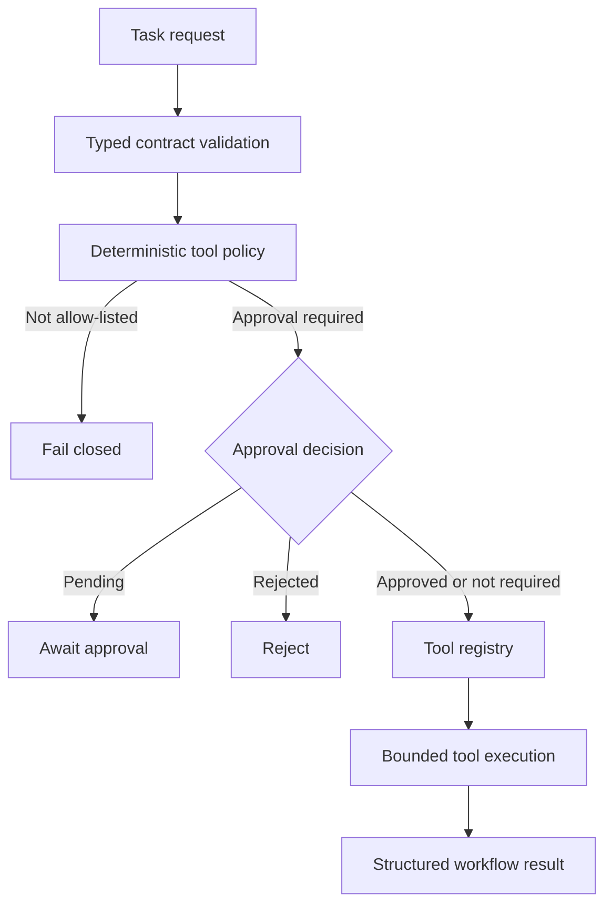

# Architecture: bounded agentic workflow

## Execution path

## Responsibilities

- **Task contract:** validates required task identifiers, objective, selected tool, and input payload.
- **Planner boundary:** a future LLM planner may propose a tool or plan. Its output is untrusted and does not grant permission.
- **Policy layer:** allow-list and approval requirements are deterministic application logic.
- **Tool registry:** exposes only explicitly registered callables.
- **Runtime:** enforces a maximum step count, contains tool exceptions, and returns a typed result.

## Trust boundaries

1. User task input is untrusted and must be validated at the application boundary.
2. Model-generated plans, when added, are untrusted proposals.
3. Tool authorization is performed by deterministic code, not natural-language model output.
4. Tool handlers are trusted application code in this starter. This implementation does not sandbox arbitrary code.
5. Tool outputs should be treated as untrusted data before being inserted into prompts or downstream systems.

## Deliberate limitations

- One tool call per run in this initial vertical slice; no multi-step planner loop yet.
- No live LLM provider, retrieval, persistent memory, or distributed state.
- Approval is supplied as an input decision; no human approval service or identity verification exists.
- No external tool execution, container isolation, network policy, or production authentication.

## Next design increments

1. Add a structured planner adapter and validate proposed plans against schemas and policy.
2. Introduce explicit state transitions and a bounded multi-step plan executor.
3. Add durable checkpoints and resumable human approval with authenticated identities.
4. Add tracing, structured audit events, offline evaluation, latency, and token/cost metrics.
5. Add integration tests against mocked provider/tool boundaries before enabling any external integration.
